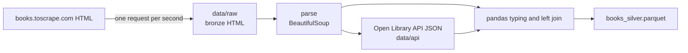

# books-scrape-to-silver

A small, polite web-scraping pipeline that turns the practice bookshop [books.toscrape.com](http://books.toscrape.com) into a typed, analysis-ready table. It walks all 50 catalogue pages and visits all 1,000 book pages, enriches titles from the Open Library Search API, and writes a silver Parquet file. Every page and API response is cached on disk first, so reruns make no requests and the tests run fully offline.



## Run it in three commands

```bash
python -m pip install -r requirements.txt -e .
python -m books_pipeline --pages 50
python -m pytest -q
```

1. **Install** the dependencies and the `books_pipeline` package.
2. **Run the pipeline.** It walks the catalogue, visits each book page for `category` and `upc`, checks the result (expected row count, unique URLs, no blank `category` or `upc`, no repeated `upc`), looks up the first 20 titles in Open Library, and writes `data/books_silver.parquet` and `.csv`. It ends with `run complete` (exit 0) or `run INCOMPLETE` (exit 1). From an empty cache that is about 1,050 requests at one per second, roughly 20 minutes; a cached rerun takes about 25 seconds.
3. **Test.** 31 tests against saved HTML pages and JSON responses in `tests/fixtures/`. `requests.get` is patched to raise, so no test can touch the network.

Set `BOOKS_SCRAPER_CONTACT` to your email before scraping so the sites can reach you; it goes in the User-Agent. Options: `--enrich-limit N` (titles to look up, default 20) and `--data-dir PATH` (default `data`).

## Layout

```
src/books_pipeline/
├── config.py     URLs, request settings, data paths, User-Agent
├── fetch.py      one polite GET; load HTML/JSON from cache or fetch and save
├── parse.py      catalogue page, next link, book page (pure functions)
├── crawl.py      catalogue walk, book details, completeness checks
├── enrich.py     Open Library lookup and flattening
├── silver.py     typing, left join, decade, aggregates, write
└── cli.py        python -m books_pipeline
tests/            31 offline tests + fixtures (3 HTML pages, 2 JSON responses)
notebooks/        analysis.ipynb, the original exploratory notebook with outputs
docs/             DATA_DICTIONARY.md, lessons.md
data/sample/      first 25 rows of the silver table
```

## Results

From the notebook (first five catalogue pages, 100 books; first 20 titles looked up, 15 matched):

**Books and average price by star rating**

| rating | books | average price (GBP) |
|---|---|---|
| 1 | 22 | 35.52 |
| 2 | 19 | 35.91 |
| 3 | 22 | 36.84 |
| 4 | 18 | 33.98 |
| 5 | 19 | 30.01 |

**Average price by first-publication decade** (matched books only)

| decade | books | average price (GBP) |
|---|---|---|
| 1980 | 1 | 51.77 |
| 1990 | 3 | 30.62 |
| 2000 | 2 | 41.42 |
| 2010 | 7 | 39.80 |
| 2020 | 2 | 38.42 |

Over the full 1,000-book catalogue the rating pattern flattens out: average prices sit between £34.56 and £36.09 for every star rating, so the cheaper five-star books in the first 100 were a small-sample effect. The decade table rests on 15 title-only matches, some of them wrong (next section), so read it as a demonstration of the join, not a finding.

## Data-quality lessons

- **Title-only matching is unreliable.** In a hand check of five Open Library matches, 2 were the wrong book: *Sapiens* matched a 2020 summary book, and *Shakespeare's Sonnets* matched a book about the sonnets. Wrong matches feed wrong years into the decade averages.
- **Encoding.** The site sends no charset, so `£` decoded as `£` until the bytes were decoded explicitly as UTF-8. A test on the price sign caught it.
- **Odd values can be real.** The categories `Default` and `Add a comment` are what the site shows, not scraping bugs.
- **Product codes stay text.** `upc` is never converted to a number.

More in [docs/lessons.md](docs/lessons.md); column definitions in [docs/DATA_DICTIONARY.md](docs/DATA_DICTIONARY.md).

## Scraping rules the code follows

- One request per second; the pause sits inside `fetch.polite_get()`, the only function that makes a request.
- Every request carries a User-Agent naming the project and a contact address.
- A page or response already saved is read from disk, never fetched again, and pages are saved as the exact bytes served.
- No API keys, passwords or tokens are needed.

---

Built for ADSP 31011 Cloud-Native Data Engineering, University of Chicago, Autumn 2026.
